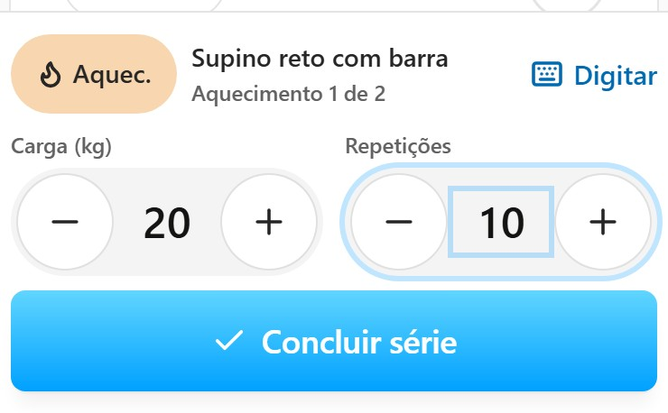
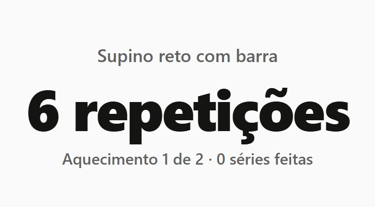
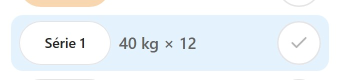
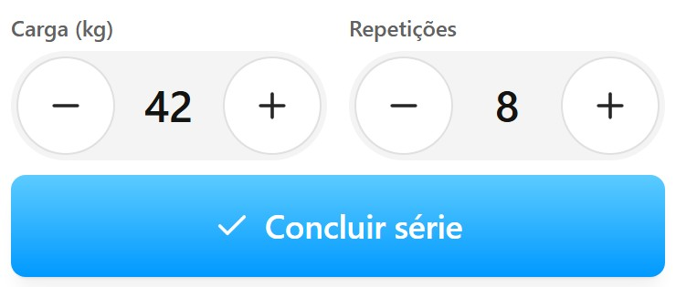
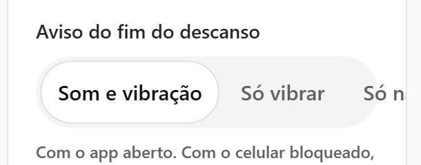
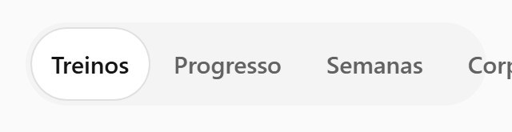

# Anilha | Dossiê de UI/UX

**22/10/2026 | Codex | Base `f741f92` | Branch `codex/dossie-uiux`**

## Parecer executivo

O Anilha já tem identidade visual e uma jornada de treino reconhecível. A prioridade é tornar o registro coerente entre telas, proteger ações de salvar e corrigir barreiras de leitura e navegação. Recomendo preservar o Harbor UI e trabalhar primeiro na confiança de uso.

**18 achados: 3 P1, 14 P2 e 1 P3.** Os três P1 foram reproduzidos localmente. Nenhuma correção de interface foi implementada nesta entrega.

### Corrigir primeiro

1. UX-01: um rascunho único para editor e foco.
2. UX-02: recusar progressão deve atualizar o controle que grava a série.
3. UX-14: uma intenção de salvar deve gerar uma corrida.

## Método, cobertura e limites

Auditoria heurística, inspeção do código e coleta local em Chromium. Nove rotas em 390 e 320 px, menu desktop em 1440 px, temas claro/escuro e cenários de treino, planejamento, cadastro e assistente. Base inclui a revisão final do Claude, f741f92. Nenhuma interface ou regra do app foi alterada.
Sem entrevistas ou métricas de uso, leitor de tela real, iPhone/Safari instalado ou produção. A resposta longa do assistente foi simulada localmente. A duplicação de corrida foi testada com dois eventos DOM consecutivos; a frequência desse problema no uso real não foi medida. Esta análise não é certificação integral de acessibilidade.

Sete cenários de investigação concluídos em 50,2 s, com 30 observações e 31 capturas. Os probes verificam/coletam comportamentos; sucesso do script não significa ausência de problemas de UX. Não repetimos a suíte completa que o Claude já registrou para f741f92.

**Escala:** P1 = pode gravar dados incorretos/duplicados; P2 = quebra de controle, leitura, entendimento ou continuidade; P3 = oportunidade de produto que exige teste com pessoas. Prioridade é julgamento técnico, sem estimativa de frequência real.

**Evidência:** reproduzido = observado nos probes; código/cálculo = fluxo ou propriedade verificada sem tarefa completa; hipótese = efeito no comportamento ainda não medido.

## O que preservar

- Cinco áreas principais com rótulos visíveis: Histórico, Plano, Hoje, Amigos e Você.
- Ação de concluir série e ajuste de valores próximos ao polegar, com áreas grandes de toque.
- Harbor UI consistente em cores, cards, cantos, tipografia e temas claro/escuro.
- Folhas com dialog nativo, campos com labels reais e estados semânticos em switches e escolhas.
- Modo foco reduz informação durante o esforço; Como fazer oferece ajuda no contexto do exercício.
- Plano explica suas escolhas; propostas do assistente exigem salvar e oferecem desfazer.

## Achados priorizados

| ID    | Prioridade | Área                  | Achado                                                    |
| ----- | ---------- | --------------------- | --------------------------------------------------------- |
| UX-01 | P1         | Treino / modo foco    | O foco usa valores anteriores à edição                    |
| UX-02 | P1         | Treino / progressão   | Recusar a progressão não atualiza o editor                |
| UX-03 | P2         | Plano                 | Trocar dias descarta o horário que está na tela           |
| UX-04 | P2         | Cadastro / perfil     | Interrupções apagam trabalho de configuração              |
| UX-05 | P2         | Sistema visual        | O texto dos CTAs tem contraste insuficiente               |
| UX-06 | P2         | Responsividade        | Opções ficam cortadas em largura de 320 px                |
| UX-07 | P2         | Foco / acessibilidade | A camada visual não isola os controles encobertos         |
| UX-08 | P2         | Navegação desktop     | Abrir Sua conta pelo teclado não leva às ações            |
| UX-09 | P2         | Assistente            | A digitação toma a posição de leitura                     |
| UX-10 | P2         | Assistente / revisão  | Revise a proposta não oferece todos os detalhes           |
| UX-11 | P2         | Entrada               | Falha de rede culpa o código de acesso                    |
| UX-12 | P2         | Hoje                  | Ignorar sugestão esconde texto, mas mantém o treino       |
| UX-13 | P2         | Histórico             | Repetir este treino busca outra sessão                    |
| UX-14 | P1         | Corrida / salvar      | Salvar aceita reentrada e cria atividades duplicadas      |
| UX-15 | P2         | Treino / orientação   | O foco omite orientações que mudam a execução             |
| UX-16 | P2         | Acessibilidade visual | Foco e switches desligados têm pouca definição            |
| UX-17 | P2         | Histórico / gráficos  | A evolução perde contexto temporal e alternativa completa |
| UX-18 | P3         | Ativação              | Testar um caminho mais curto até o primeiro valor         |

### UX-01 · P1 · O foco usa valores anteriores à edição

**Área:** Treino / modo foco. **Evidência:** Reproduzido no navegador e na leitura do banco local.

**Cenário:** Abrir um treino novo, entrar no foco, tocar Ajustar, digitar 20 kg e 10 repetições e voltar ao foco antes de concluir.

**Observado:** O editor mostra 20/10, o foco mostra 6 repetições e Série feita grava uma série de aquecimento com carga nula e 6 repetições.

**Impacto:** O registro pode divergir da intenção da pessoa. Alternar a apresentação da mesma série não deveria trocar seus valores.

**Recomendação:** Compartilhar um único rascunho por série entre editor completo e foco; salvar e restaurar os mesmos valores nas duas apresentações.

**Aceite:** Editar 20/10, alternar os modos nas duas direções e concluir mantém e grava 20 kg e 10 repetições, inclusive após outras edições.

**Código:** `src/screens/Session.tsx:841`; `src/screens/parts/FocusMode.tsx:74`; `src/screens/parts/FocusMode.tsx:176`.

**Registro:** `focus-draft`, `focus-saved` em [observations.jsonl](evidence/uiux-2026-10-22/observations.jsonl).

### UX-02 · P1 · Recusar a progressão não atualiza o editor

**Área:** Treino / progressão. **Evidência:** Reproduzido no navegador.

**Cenário:** Após duas sessões de 40 kg no topo da faixa, iniciar a próxima, selecionar uma série de trabalho e tocar Ignorar sugestão.

**Observado:** O cartão passa a 40 kg × 12; o controle principal continua em 42 kg × 8. Ele mantém seu estado inicial mesmo após a atualização da série.

**Impacto:** A pessoa recusa uma alteração, mas o controle usado para concluir ainda apresenta a alteração recusada. O problema persiste após a correção de pirâmide do Claude.

**Recomendação:** Sincronizar o rascunho ao aceitar ou recusar uma sugestão; tratar separadamente uma edição manual deliberada para não apagá-la.

**Aceite:** Depois de recusar 42 kg, cartão, editor, foco e gravação mostram 40 kg. Uma edição manual posterior continua prevalecendo.

**Código:** `src/screens/Session.tsx:431`; `src/screens/Session.tsx:467`; `src/screens/Session.tsx:841`.

**Registro:** `dismiss-progression` em [observations.jsonl](evidence/uiux-2026-10-22/observations.jsonl).

### UX-03 · P2 · Trocar dias descarta o horário que está na tela

**Área:** Plano. **Evidência:** Reproduzido no navegador e no banco local.

**Cenário:** Abrir segunda-feira, alterar o horário de 06:00 para 07:45 e tocar Trocar com terça sem Salvar dia antes.

**Observado:** A folha fecha; o treino vai para terça às 06:00. O horário 07:45 exibido antes da troca é perdido.

**Impacto:** Duas ações no mesmo formulário operam sobre estados diferentes. A confirmação da troca transmite sucesso sem explicar o descarte.

**Recomendação:** Aplicar a troca sobre o rascunho atual ou separar edição e troca, pedindo descarte explícito quando houver mudanças.

**Aceite:** Alterar horário/tipo e trocar preserva o conteúdo exibido ou informa a perda antes de confirmar. Nunca perde silenciosamente o rascunho.

**Código:** `src/screens/parts/PlanDaySheet.tsx:47`; `src/screens/parts/PlanDaySheet.tsx:64`.

**Registro:** `day-swap`, `day-swap-ui` em [observations.jsonl](evidence/uiux-2026-10-22/observations.jsonl).

### UX-04 · P2 · Interrupções apagam trabalho de configuração

**Área:** Cadastro / perfil. **Evidência:** Cadastro reproduzido no navegador; perfil rastreado no código.

**Cenário:** Preencher o cadastro até Quanto tempo por treino e recarregar. No perfil, editar uma resposta e navegar para outra área antes de gerar o plano.

**Observado:** O cadastro volta a Vamos montar seu plano, perdendo a etapa e as respostas ainda não adotadas. O perfil também usa rascunho apenas em estado local da tela.

**Impacto:** Interrupções comuns no celular obrigam a repetir decisões. Pronto na folha do perfil pode parecer persistência, embora o plano ainda não tenha sido gerado.

**Recomendação:** Rascunho por conta com retomada e indicação Mudanças ainda não aplicadas; proteger a saída. Preservar respostas também diante de erros de gravação.

**Aceite:** Recarregar retoma etapa e respostas. Sair do perfil alterado preserva rascunho ou pede descarte; o que foi salvo e o que falta aplicar fica explícito.

**Código:** `src/screens/Onboarding.tsx:137`; `src/screens/TrainingProfile.tsx:91`; `src/screens/TrainingProfile.tsx:136`.

**Registro:** `onboarding-reload` em [observations.jsonl](evidence/uiux-2026-10-22/observations.jsonl).

### UX-05 · P2 · O texto dos CTAs tem contraste insuficiente

**Área:** Sistema visual. **Evidência:** Estilos computados no navegador e cálculo de contraste.

**Cenário:** Ler botões principais com texto branco e o gradiente azul; no tema escuro, ler confirmações com fundo danger.

**Observado:** Branco contra os extremos do gradiente resulta em 1,8354:1 e 2,9998:1. Branco sobre danger escuro resulta em 2,7869:1. O texto primário é 18 px, peso 600.

**Impacto:** A hierarquia chama atenção, mas a leitura da ação principal é difícil para pessoas com baixa visão e em iluminação ruim.

**Recomendação:** Escurecer a área sob o texto branco ou adotar outra combinação acessível; manter o azul vivo como acento. O requisito usual para esse texto é 4,5:1 [R1].

**Aceite:** Texto ativo alcança pelo menos 4,5:1 sob todos os glifos, nos dois temas e no hover. Texto de 18 px não deve ser tratado como 18 pontos.

**Código:** `design/harbor-ui/components.css:13`; `design/harbor-ui/extensions.css:38`; `design/harbor-ui/extensions.css:45`.

**Registro:** `tokens-light`, `tokens-dark` em [observations.jsonl](evidence/uiux-2026-10-22/observations.jsonl).

### UX-06 · P2 · Opções ficam cortadas em largura de 320 px

**Área:** Responsividade. **Evidência:** Reproduzido no navegador em emulação configurada para 320 px.

**Cenário:** Abrir Ajustes e Histórico em uma tela estreita, ou numa configuração equivalente de ampliação.

**Observado:** Aviso do fim do descanso tem 248 px disponíveis e 316 px de conteúdo; Só na tela fica cortado. No Histórico, o seletor tem 288 px e conteúdo de 330 px; Corpo perde visibilidade e o viewport interno expande para 347 px.

**Impacto:** A pessoa não enxerga todas as escolhas. O problema não aparece na largura padrão de 390 px usada em boa parte dos testes.

**Recomendação:** Permitir quebra dos rótulos, organizar opções verticalmente ou adaptar o seletor. Conteúdo essencial deve refluir sem perda [R3].

**Aceite:** Todas as opções permanecem legíveis e acionáveis em 320 px e com texto ampliado a 200%, sem recorte ou rolagem horizontal da página.

**Código:** `src/screens/Settings.tsx:89`; `src/screens/History.tsx:79`; `design/harbor-ui/extensions.css:140`.

**Registro:** `ajustes-320`, `historico-320` em [observations.jsonl](evidence/uiux-2026-10-22/observations.jsonl).

### UX-07 · P2 · A camada visual não isola os controles encobertos

**Área:** Foco / acessibilidade. **Evidência:** DOM inspecionado no navegador e código.

**Cenário:** Entrar no modo foco e navegar por teclado ou tecnologia assistiva.

**Observado:** A tela completa permanece montada atrás de uma região comum. O input do editor encoberto tem tabindex 0, sem ancestral inert ou aria-hidden; não há transferência explícita de foco para a superfície ativa.

**Impacto:** Controles que não correspondem à tela visível continuam participando da navegação. Leitor de tela real ainda precisa ser validado.

**Recomendação:** Isolar a superfície ativa, mover o foco para um controle visível e restaurá-lo ao sair, preservando o rascunho compartilhado.

**Aceite:** Durante o foco, Tab e navegação assistiva percorrem somente o conteúdo ativo. Sair devolve o foco a um lugar previsível.

**Código:** `src/screens/parts/FocusMode.tsx:88`; `src/screens/Session.tsx:310`; `src/styles/app.css:1637`.

**Registro:** `focus-background` em [observations.jsonl](evidence/uiux-2026-10-22/observations.jsonl).

### UX-08 · P2 · Abrir Sua conta pelo teclado não leva às ações

**Área:** Navegação desktop. **Evidência:** Reproduzido no navegador.

**Cenário:** No desktop, focar Sua conta, pressionar Enter e depois Tab.

**Observado:** O próximo foco foi Entendi na tela Hoje, fora do menu. Os itens são inseridos antes do gatilho no DOM, sem posicionar o foco na primeira ação.

**Impacto:** O menu aparece, mas a sequência de navegação pula suas opções; seus papéis menu/menuitem prometem um comportamento que não está completo.

**Recomendação:** Implementar o padrão completo de menu ou usar uma lista de links/botões com sequência de foco coerente.

**Aceite:** Abrir entra na primeira ação; todas as ações são alcançáveis em ordem previsível; Escape fecha e devolve foco ao gatilho.

**Código:** `src/ui/nav.tsx:261`; `src/ui/nav.tsx:291`; `src/ui/nav.tsx:316`.

**Registro:** `menu-keyboard` em [observations.jsonl](evidence/uiux-2026-10-22/observations.jsonl).

### UX-09 · P2 · A digitação toma a posição de leitura

**Área:** Assistente. **Evidência:** Reproduzido com resposta longa simulada localmente.

**Cenário:** Durante a animação de uma resposta longa, voltar a rolagem ao topo para reler o pedido ou comparar uma proposta anterior.

**Observado:** A posição foi colocada em 0 e voltou ao fim enquanto o texto crescia. Cada atualização chama follow, que força scrollTop para scrollHeight, sem considerar intenção de leitura.

**Impacto:** A pessoa perde o controle da conversa durante alguns segundos. É uma regressão da mudança recente que restaurou a digitação no popup.

**Recomendação:** Acompanhar somente quando a pessoa já estiver próxima ao fim; suspender após rolagem manual e oferecer Ir para a resposta mais recente.

**Aceite:** Rolar para cima durante a digitação mantém a posição até a pessoa voltar ao fim. Reabrir continua mostrando a resposta inteira sem redigitar.

**Código:** `src/screens/AgentChat.tsx:202`; `src/screens/AgentChat.tsx:598`.

**Registro:** `agent-scroll` em [observations.jsonl](evidence/uiux-2026-10-22/observations.jsonl).

### UX-10 · P2 · Revise a proposta não oferece todos os detalhes

**Área:** Assistente / revisão. **Evidência:** Código e inspeção visual dos cartões existentes.

**Cenário:** Pedir plano novo e tentar revisar exercícios, séries, repetições e descanso antes de Salvar. Em ficha nova, conferir o descanso de cada exercício.

**Observado:** Plano novo mostra mudanças no perfil e nomes das fichas, sem listar os exercícios/doses de cada uma. A ficha nova lista exercícios e repetições, mas omite descanso.

**Impacto:** A pessoa aceita uma mudança antes de conseguir inspecionar informações essenciais do que será gravado.

**Recomendação:** Detalhes expansíveis por ficha, com exercícios, doses, descanso e origem. Manter o resumo e os avisos como primeira camada.

**Aceite:** Todo dado relevante que será alterado pode ser conferido antes de salvar, sem exigir aplicar e desfazer como forma de prévia.

**Código:** `src/screens/AgentChat.tsx:703`; `src/screens/AgentChat.tsx:731`; `src/screens/AgentChat.tsx:769`.

### UX-11 · P2 · Falha de rede culpa o código de acesso

**Área:** Entrada. **Evidência:** Tratamento de erros rastreado no código; cenário offline não executado nesta coleta.

**Cenário:** Receber código válido, perder conexão e completar os seis dígitos.

**Observado:** Qualquer erro diferente de 429 vira Código inválido ou expirado, apaga os seis dígitos e volta o foco para o início.

**Impacto:** A mensagem induz uma ação desnecessária, como pedir outro código, em vez de recuperar a conexão.

**Recomendação:** Distinguir código recusado, rede e serviço indisponível; preservar a entrada em falhas transitórias e permitir nova tentativa.

**Aceite:** Uma falha simulada de rede mantém os dígitos e mostra uma ação de repetir a verificação. Código realmente recusado recebe sua mensagem específica.

**Código:** `src/screens/Auth.tsx:110`; `src/screens/Auth.tsx:124`.

### UX-12 · P2 · Ignorar sugestão esconde texto, mas mantém o treino

**Área:** Hoje. **Evidência:** Fluxo do código e tela Hoje inspecionados; expectativa de usuários é hipótese.

**Cenário:** Em Hoje, recusar uma recomendação que difere do plano e depois tocar Iniciar treino.

**Observado:** ignored só esconde explicação e alertas. O treino recomendado, os itens e a ação de início continuam iguais; o texto passa a mencionar o plano.

**Impacto:** O rótulo permite interpretar que a recomendação foi recusada, embora o mesmo treino ainda seja iniciado.

**Recomendação:** Decidir o contrato da ação: Ocultar explicação, se esse for o efeito; ou oferecer Seguir o plano / Treinar assim com prévia clara.

**Aceite:** Após o toque, a pessoa identifica sem ambiguidade qual treino será iniciado. Alertas relevantes não somem apenas por ocultar uma explicação.

**Código:** `src/screens/Today.tsx:492`; `src/screens/Today.tsx:524`; `src/screens/Today.tsx:620`.

### UX-13 · P2 · Repetir este treino busca outra sessão

**Área:** Histórico. **Evidência:** Seleção da fonte rastreada no código; cenário com duas sessões distintas não executado.

**Cenário:** Abrir no histórico um treino antigo de uma divisão que teve uma sessão mais recente com exercícios diferentes; escolher Repetir este treino.

**Observado:** O início usa itemsFromLastSession(split), que busca a sessão mais recente da divisão, e não o ID selecionado.

**Impacto:** Título e ponto de entrada remetem à sessão antiga, mas os exercícios podem vir de outra sessão.

**Recomendação:** Repetir o conteúdo da sessão escolhida ou nomear explicitamente Repetir o último treino desta divisão.

**Aceite:** Duas sessões diferentes da mesma divisão têm repetição previsível: o conteúdo é o selecionado, ou a origem alternativa é informada antes de iniciar.

**Código:** `src/screens/parts/SessionActions.tsx:23`; `src/screens/parts/SessionActions.tsx:87`; `src/data/ops.ts:337`.

### UX-14 · P1 · Salvar aceita reentrada e cria atividades duplicadas

**Área:** Corrida / salvar. **Evidência:** Reproduzido com dois eventos de clique DOM consecutivos no navegador.

**Cenário:** Preencher corrida de 5 km em 30:00 e acionar Salvar corrida duas vezes antes de a primeira gravação terminar.

**Observado:** O banco local recebeu duas atividades de 5 km e 1.800 segundos. O botão não tem trava imediata nem estado de salvamento.

**Impacto:** Uma intenção pode alterar duas vezes o histórico, as distâncias e a constância. A frequência em toques humanos reais não foi medida.

**Recomendação:** Trava síncrona de reentrada, estado Salvando e persistência idempotente onde cabível; erro recuperável que mantém os campos.

**Aceite:** Dois acionamentos concorrentes resultam em uma atividade. Falha mantém os dados preenchidos e permite nova tentativa com resultado claro.

**Código:** `src/screens/sheets/RunSheet.tsx:269`; `src/screens/sheets/RunSheet.tsx:306`; `src/data/ops.ts:1080`.

**Registro:** `run-double-submit` em [observations.jsonl](evidence/uiux-2026-10-22/observations.jsonl).

### UX-15 · P2 · O foco omite orientações que mudam a execução

**Área:** Treino / orientação. **Evidência:** Comparação de propriedades e conteúdo das duas telas no código.

**Cenário:** Abrir diretamente no foco memorizado durante retorno, semana leve ou com alerta de exercício.

**Observado:** A tela completa tem orientações de retorno, semana leve, dor e teto de volume. Elas não são passadas para a superfície de foco, que mostra valores e ação de concluir.

**Impacto:** Reduzir informação pode esconder o contexto necessário para interpretar os valores. A pessoa pode não abrir a tela completa.

**Recomendação:** Uma linha prioritária da orientação ativa, com acesso aos detalhes. Definir precedência para evitar empilhar todos os avisos.

**Aceite:** Ao entrar direto no foco, a orientação ativa relevante aparece antes da primeira série; a composição continua simples e legível.

**Código:** `src/screens/Session.tsx:335`; `src/screens/Session.tsx:491`; `src/screens/parts/FocusMode.tsx:88`.

### UX-16 · P2 · Foco e switches desligados têm pouca definição

**Área:** Acessibilidade visual. **Evidência:** Tokens computados no navegador e cálculo de contraste.

**Cenário:** Navegar por Tab e localizar controles desligados em Ajustes ou Privacidade.

**Observado:** O anel azul translúcido alcança cerca de 1,31:1 no branco e 1,46:1 no fundo escuro. O trilho desligado do switch tem 1,27:1 e 1,32:1 contra a superfície, sem uma borda definida.

**Impacto:** O estado de foco e a presença do controle dependem de diferenças tênues. O estado semântico e o label dos switches já estão corretos e devem ser preservados.

**Recomendação:** Outline sólido e contorno/estado desligado com distinção suficiente. Partes necessárias para identificar controles e estados devem atender 3:1 [R2].

**Aceite:** Identificar foco e estado desligado nos dois temas com pelo menos 3:1, preservando forma/posição e testando cores forçadas e teclado.

**Código:** `design/harbor-ui/tokens.css:59`; `design/harbor-ui/extensions.css:34`; `design/harbor-ui/extensions.css:171`.

**Registro:** `tokens-light`, `tokens-dark` em [observations.jsonl](evidence/uiux-2026-10-22/observations.jsonl).

### UX-17 · P2 · A evolução perde contexto temporal e alternativa completa

**Área:** Histórico / gráficos. **Evidência:** Código e cálculo do posicionamento dos pontos; leitor de tela real não usado.

**Cenário:** Comparar evolução com intervalos longos entre treinos, ou consultar a série de 1RM estimado sem enxergar o gráfico.

**Observado:** O eixo X usa o índice das datas: 01/10, 02/10 e 22/10 ficam igualmente espaçados. O nome acessível resume apenas a série principal, omitindo os pontos da curva comparativa.

**Impacto:** Uma pausa pode parecer evolução contínua, e parte do histórico visual não tem alternativa textual equivalente.

**Recomendação:** Posicionar por dias decorridos ou rotular explicitamente por sessão. Oferecer tabela com data, valor e unidade das duas séries.

**Aceite:** Intervalos de 1 e 20 dias têm proporção temporal correta ou eixo declarado por sessão; todas as séries e seus dados ficam disponíveis em texto.

**Código:** `src/ui/charts.tsx:62`; `src/ui/charts.tsx:75`; `src/screens/parts/ExerciseProgress.tsx:84`.

### UX-18 · P3 · Testar um caminho mais curto até o primeiro valor

**Área:** Ativação. **Evidência:** 12 etapas verificadas na interface/código; efeito no abandono não medido.

**Cenário:** Pessoa nova quer experimentar o treino e percorre nome, idade, objetivo, foco, nível, pausa, local, semana, duração, divisão, gênero e plano. Prova pode acrescentar uma etapa.

**Observado:** Uma pergunta por tela orienta bem, mas decisões avançadas, como divisão, entram antes do primeiro uso. A sugestão já existe, porém não há atalho global para aceitar as sugestões restantes.

**Impacto:** É hipótese de esforço inicial maior do que o necessário; não há dados para afirmar abandono ou prever ganho de conversão.

**Recomendação:** Prototipar Usar as sugestões após os dados essenciais, com revisão final e ajustes avançados disponíveis depois. Em Hoje, priorizar a próxima ação e resumir avisos extensos.

**Aceite:** Comparar os dois fluxos em tarefas reais, medindo tempo, conclusão, compreensão e confiança. Não remover dados necessários ao motor sem revisar a regra.

**Código:** `src/screens/Onboarding.tsx:77`; `src/screens/Onboarding.tsx:152`; `src/screens/parts/trainingQuestions.tsx:591`.

**Registro:** `onboarding-reload` em [observations.jsonl](evidence/uiux-2026-10-22/observations.jsonl).

## Evidências visuais

Recortes das capturas locais de contas de teste. Em 12/11/2026, a revisão de privacidade identificou origem pessoal na fixture usada pela coleta e retirou uma captura complementar da árvore pública. As seis imagens exibidas abaixo permanecem como evidências históricas dos cenários de interface. O tratamento e os limites estão no parecer [de preparação do repositório público](REVISAO_CODEX_REPO_PUBLICO_2026-11-12.md).

**Editor antes de alternar: 20 kg e 10 repetições**



**Foco depois de alternar: 6 repetições**



**Após recusar: cartão mostra 40 kg × 12**



**Após recusar: editor permanece em 42 kg × 8**



**Ajustes em 320 px: última opção cortada**



**Histórico em 320 px: Corpo cortado**



## Plano de ação

| Ordem | Objetivo                   | Itens                       | Aceite de saída                                                                   |
| ----- | -------------------------- | --------------------------- | --------------------------------------------------------------------------------- |
| 1     | Confiabilidade do registro | UX-01, UX-02, UX-14         | Uma fonte de valores por série; recusa respeitada; corrida sem reentrada          |
| 2     | Continuidade e acesso      | UX-03 a UX-08, UX-16        | Rascunhos preservados; escolhas legíveis a 320 px; contraste e teclado conferidos |
| 3     | Clareza e controle         | UX-09 a UX-13, UX-15, UX-17 | Leitura controlável, proposta inspecionável, ações com origem/efeito previsíveis  |
| 4     | Ativação                   | UX-18                       | Protótipo comparado com o fluxo atual em tarefas com pessoas                      |

### Protocolo de avaliação com pessoas

Rodada qualitativa proposta com seis participantes: três novos e três habituados a musculação. Não interpretar uma amostra pequena como estimativa estatística de conversão. Tarefas: montar plano; começar e corrigir série; alternar foco; recusar progressão; mudar dia e horário; conferir proposta; registrar uma corrida. Observar tempo, conclusão sem ajuda, erros, recuperações e explicação do que foi salvo. Incluir uma rodada com teclado/leitor de tela e outra em iPhone instalado.

### Direção visual recomendada

Preservar Harbor UI, cinco áreas e paleta semântica. Reforçar contraste da ação principal, hierarquia da próxima tarefa e distinção entre salvo, rascunho e proposta. Usar divulgação progressiva para regras, fichas e avisos; manter contexto indispensável no foco. Não há redesenho implementado neste dossiê.

## Revisão mútua com o Claude

A correção de pirâmide e a reabertura sem redigitar já estão em f741f92; não foram contadas como problemas antigos. A animação restaurada introduz o problema de controle de rolagem UX-09, reproduzido nesta coleta. O restante da regra de progressão, incluindo qual série desce, exige revisão funcional própria e não foi aprovado integralmente nesta auditoria de UI/UX.

O Claude deve revisar os três P1 e os critérios de aceite antes de implementar. Teclado do iPhone continua hipótese a validar em aparelho real. Nenhum deploy, merge na main ou chamada real ao modelo ocorreu.

## Reproduzir a coleta

```powershell
npx playwright test -c scripts/audits/uiux.config.ts
```

Os testes usam API/banco locais e resposta de modelo simulada no caso de rolagem. Evidências cruas vão para `artifacts/uiux-evidence`; os registros retidos estão em `docs/evidence/uiux-2026-10-22/`.

## Fontes e referências

Código e interface: Anilha f741f92. Critérios externos consultados em 22/10/2026:

- [R1: W3C: WCAG 2.2, contraste de texto](https://www.w3.org/WAI/WCAG22/Understanding/contrast-minimum.html)

- [R2: W3C: contraste não textual](https://www.w3.org/WAI/WCAG22/Understanding/non-text-contrast.html)

- [R3: W3C: reflow em 320 CSS px](https://www.w3.org/WAI/WCAG22/Understanding/reflow.html)

- [R4: W3C: tamanho mínimo dos alvos, 24 CSS px com exceções](https://www.w3.org/WAI/WCAG22/Understanding/target-size-minimum)

- [R5: Nielsen Norman Group: heurísticas de usabilidade](https://www.nngroup.com/articles/ten-usability-heuristics/)

A meta prática de 44 px do produto é diferente do mínimo WCAG AA de 24 CSS px, que tem exceções. Não foram considerados conformidade integral, taxa de abandono ou ganho de desempenho sem medição.
